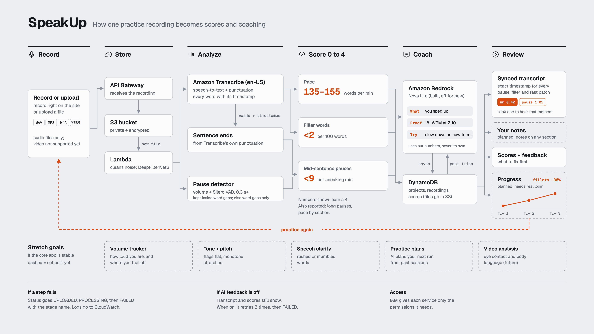

# SpeakUp

SpeakUp is a DS3 public-speaking coach. A student records or uploads a practice
talk, and SpeakUp scores three things on a 0 to 4 scale: speaking rate, filler
words, and pauses inside sentences. It then shows a timestamped transcript with
the fillers and pauses marked, plus written coaching feedback.

**Status:** the AWS backend is deployed for development. The web app in
`frontend/web` runs on sample data and is not connected to the live API yet.

## How it works



1. The browser uploads the original recording straight to a private S3 bucket.
   The original is never changed.
2. The S3 upload event starts a Step Functions workflow.
3. **Audio prep** (Lambda container): converts the file to 48 kHz mono and
   removes background noise with DeepFilterNet3.
4. **Transcription:** Amazon Transcribe (en-US) returns the words with
   timestamps and punctuation.
5. **Scoring:** plain Python code in `src/scoring/` counts words per minute,
   fillers and pauses, then scores them with the rubric in
   [`src/scoring/rubrics/speaking-2026-10-31.csv`](src/scoring/rubrics/speaking-2026-10-31.csv).
6. **Feedback:** Amazon Bedrock writes structured coaching (an overview, four
   categories and timestamped moments) from the scores. It only runs when the
   stack is deployed with `EnableBedrockFeedback=true`. See
   [docs/bedrock-upload-pipeline.md](docs/bedrock-upload-pipeline.md).
7. Results are saved to S3 and DynamoDB, and the web app reads them through
   API Gateway after the user signs in with Cognito.

Step by step detail: [docs/full-pipeline-walkthrough.md](docs/full-pipeline-walkthrough.md).

## Models and why we picked them

| Step | Model | Why |
| --- | --- | --- |
| Noise cleanup | DeepFilterNet3 | Removes background noise while keeping speech intact, and runs on CPU inside Lambda |
| Speech to text | Amazon Transcribe (en-US) | Keeps um and uh in the transcript (normal Whisper dropped most of them) and gives word timestamps and punctuation |
| Pause detection | A quiet stretch of 0.3 s or more (energy), or Silero VAD hearing no speech at a Transcribe word gap | Silero also catches pauses filled with laughter, clapping or breathing, which are not quiet. Only pauses inside a sentence count against the score. Falls back to Transcribe word gaps when the audio-prep step has no pause data |
| Feedback | Amazon Bedrock: Nova Lite (`converse` mode) or `openai.gpt-oss-20b` through the Mantle endpoint (`mantle-chat` mode) | Runs in our Region (`us-east-2`). Mantle was added because the dev account hit Bedrock Runtime's daily token limit. The scores come from code, so the model only writes the wording |

The research behind every rubric cutoff, the filler word list, the pause rules
and the Bedrock prompt is in [docs/research/](docs/research/README.md). Start
with [RUBRIC_README.md](docs/research/RUBRIC_README.md).

## Setup

You only need the steps for the part you are working on.

| I want to... | Steps |
| --- | --- |
| Run the tests or work on scoring and the API code | 1, 2, 3 |
| Work on the web app | 1, 4 |
| Run noise cleanup on my own audio | 1, 5 |
| Run a recording through the real AWS pipeline | 1, 2, 6, 7 |
| Deploy or change AWS resources | 1, 2, 6, then [infra/README.md](infra/README.md) |

### 1. Install the tools and clone the repo

You need Git, plus:

- **Python 3.13** for the main code and tests
- **Python 3.11** only for noise cleanup (DeepFilterNet needs it)
- **Node.js 20.9 or newer** only for the web app
- **AWS CLI 2.32 or newer** only for AWS work

On macOS with Homebrew:

```bash
brew install git python@3.13 python@3.11 node awscli
```

On Windows, install the same tools from their websites. Then:

```bash
git clone https://github.com/sux005/DS3_SpeakUp.git
cd DS3_SpeakUp
```

### 2. Set up Python and run the tests

macOS and Linux:

```bash
python3.13 -m venv .venv
source .venv/bin/activate
python -m pip install --upgrade pip
python -m pip install -r requirements-dev.txt
cp .env.development.example .env.development
```

Windows PowerShell:

```powershell
py -3.13 -m venv .venv
.\.venv\Scripts\Activate.ps1
python -m pip install -r requirements-dev.txt
Copy-Item .env.development.example .env.development
```

Run the tests:

```bash
python -m pytest -q --basetemp .test-tmp -p no:cacheprovider
```

Everything should pass. The tests do not need AWS, audio files or model downloads.

`.env.development` holds resource names, not passwords. Never put AWS keys in it.

### 3. Score a transcript on your computer

The same scoring code the AWS pipeline uses can run on any transcript with word
timestamps (raw Amazon Transcribe JSON, a SpeakUp transcript, or local Whisper
output):

```bash
python scripts/calculate_wpm.py frontend/sample-payloads/transcript.json
python scripts/count_fillers.py frontend/sample-payloads/transcript.json
```

The sample transcript is only five words long, so it prints
`"rubric_status": "insufficient_speech"` and no score. Use a real transcript to
get scores.

To make a transcript from your own audio without AWS, install the optional
Whisper model and see [Local transcription](#local-transcription-and-accuracy-review):

```bash
pip install -r requirements-transcription.txt
```

### 4. Run the web app

```bash
cd frontend/web
npm install
npm run dev
```

Open http://localhost:3000. It uses the sample data in `frontend/web/data/`, so
no AWS is needed. The `/login` page is a placeholder and lets anyone in.

The results page plays a demo talk that is not in the repo, because we don't
commit audio. Without it the page still works and shows a "No audio file found"
note. To add it, see "Demo audio" in [frontend/web/README.md](frontend/web/README.md). Screens and file layout are in
[frontend/web/README.md](frontend/web/README.md), and the API it will call is in
[docs/aws-payload-api.md](docs/aws-payload-api.md).

### 5. Run noise cleanup on your own audio

DeepFilterNet needs its own Python 3.11 environment. Keep it separate from `.venv`.

macOS and Linux:

```bash
python3.11 -m venv .venv-audio-v2
source .venv-audio-v2/bin/activate
python -m pip install --upgrade pip
python -m pip install -r requirements-audio-model.txt
python -m src.audio.preprocess path/to/recording.wav results/prepared
```

Windows PowerShell:

```powershell
py -3.11 -m venv .venv-audio-v2
.\.venv-audio-v2\Scripts\python -m pip install -r requirements-audio-model.txt
.\.venv-audio-v2\Scripts\python -m src.audio.preprocess path\to\recording.wav results\prepared
```

The output files are explained in [Audio preparation](#audio-preparation).
`results/` is ignored by Git, so your audio stays on your computer.

### 6. Get AWS access

Ask the project lead for your own AWS sign-in. Never share logins or create
access keys. Then:

```bash
aws login --profile speakup-dev
aws sts get-caller-identity --profile speakup-dev
```

Use Region `us-east-2` for every command. Details and troubleshooting:
[docs/team-aws-access.md](docs/team-aws-access.md).

### 7. Run a recording through the real pipeline

With `.venv` active and AWS access working:

```bash
python scripts/run_live_pipeline.py path/to/recording.wav
```

The script makes a test user, uploads the file the same way the web app will,
waits for the workflow to finish and saves a log of every step. Add
`--log path/to/log.jsonl` to choose where the log goes.

### Setup problems

Most install problems on Mac (PyTorch, DeepFilterNet, missing Python versions,
Docker on Apple Silicon) are covered in [docs/macos-setup.md](docs/macos-setup.md).

## Repository structure

```text
.
├── docs/
│   ├── research/            # Why the rubric, models and prompt are what they are
│   ├── flowchart/           # Pipeline diagram
│   └── *.md                 # API contract, pipeline walkthrough, AWS and setup guides
├── frontend/
│   ├── sample-payloads/     # Example API responses
│   └── web/                 # Next.js web app
├── infra/                   # CloudFormation templates and Lambda handlers
├── scripts/                 # Local scoring, QA, packaging and live pipeline runs
├── src/
│   ├── audio/               # Audio prep and noise cleanup
│   ├── aws_payload/         # Storage and recording lifecycle code for S3 and DynamoDB
│   ├── scoring/             # Rubric, fillers, pauses and the rubric CSV
│   └── transcription/       # Optional local Whisper transcription
├── tests/
├── notebooks/
├── results/                 # Local outputs, ignored by Git
└── models/                  # Downloaded model files, ignored by Git
```

## Docs

| Doc | What it covers |
| --- | --- |
| [docs/full-pipeline-walkthrough.md](docs/full-pipeline-walkthrough.md) | Every step from upload to results, and which file does it |
| [docs/aws-payload-api.md](docs/aws-payload-api.md) | API routes and response shapes for the frontend |
| [frontend/sample-payloads/](frontend/sample-payloads/README.md) | Example response for every API route |
| [docs/aws-payload-package-reference.md](docs/aws-payload-package-reference.md) | Every function in `src/aws_payload` |
| [docs/rubric-csv-format.md](docs/rubric-csv-format.md) | How to edit the rubric CSV |
| [docs/research/](docs/research/README.md) | Rubric, filler, pause and prompt research |
| [infra/README.md](infra/README.md) | Deploying, Lambda packages, the audio image, costs and cleanup |
| [docs/team-aws-access.md](docs/team-aws-access.md) | Getting AWS access |
| [docs/sign-in-process.md](docs/sign-in-process.md) | How sign-in works |
| [docs/bedrock-upload-pipeline.md](docs/bedrock-upload-pipeline.md) | The Bedrock feedback step, its modes and how to turn it on |
| [docs/research/noise_cancellation_ab.md](docs/research/noise_cancellation_ab.md) | How to compare raw and cleaned audio |
| [docs/macos-setup.md](docs/macos-setup.md) | Mac setup and fixes |
| [docs/AGENTS.md](docs/AGENTS.md) | Repo guide for AI coding tools |

Build the zip-based Lambda packages with `python scripts/build_lambda_packages.py`.

## Audio preparation

SpeakUp includes a distortion-gated, model-driven speech preparation pipeline.
Version 2 sends full-band 48 kHz mono audio to DeepFilterNet3 without fixed high-pass,
hum-notch, or presence-EQ denoising. The learned output is selected first when it
passes the speech-preservation gate; a conservative dry/model blend and the normalized
reference remain safety fallbacks. The original recording is never overwritten.

Set up `.venv-audio-v2` as in [setup step 5](#5-run-noise-cleanup-on-your-own-audio).

Generate the reproducible synthetic before/after example with:

```bash
python scripts/generate_audio_prep_example.py
```

The output directory contains `reference.wav`, `enhanced_model.wav`,
`enhanced_blended.wav`, `diagnostic.wav`, a legacy `enhanced.wav` alias, and
`report.json`. The report records the pipeline version, exact model and runtime
configuration, speech-preservation measurements, warnings, and which signal passed
the distortion-aware transcription gate.

For local QA with the private `data/raw/SPEAKUP 1.mp4` through `SPEAKUP 6.mp4`
recordings, activate `.venv-audio-v2` and run
`python scripts/run_real_audio_qa.py`.
The command writes one
ignored `results/real_audio_qa/<clip>/` directory per source file. Each
`report.json` records the source filename and SHA-256 of the exact input bytes.
The runner skips identical source bytes within a batch and reuses a prior
result only when its report matches the source and processing configuration and
all expected artifacts exist. Changed inputs or incomplete outputs are rerun.
The six-file end-to-end test below checks the same source files using temporary
outputs. Generated QA artifacts remain ignored by Git.

## Local transcription and accuracy review

Install the optional local ASR dependency with
`pip install -r requirements-transcription.txt`, then run
`python scripts/transcribe_local.py`.
The default `small.en` model downloads once into the ignored `models/` directory.
The command reads the six original MP4 files and writes one ignored
`results/local_transcripts/<clip>/transcript.json` per file. Each automatic
transcript contains the source SHA-256, model details, full text, segments, and
word start/end times. It is a hypothesis, not verified ground truth.

Run `python scripts/create_review_templates.py` to prefill ignored
`data/references/SPEAKUP x.json` files with the automatic transcript and its
word-timestamped segments. Existing reviewed text is preserved. To measure
transcription accuracy, listen to each source recording, correct the reference
`text` to the exact words heard, and change `review_status` to `reviewed`:

```json
{
  "source_sha256": "copy the hash from the automatic transcript",
  "review_status": "reviewed",
  "text": "the exact words confirmed by listening to the recording"
}
```

Run the comparison after review:

```bash
python scripts/check_transcript_accuracy.py \
  "results/local_transcripts/SPEAKUP 1/transcript.json" \
  "data/references/SPEAKUP 1.json"
```

The checker rejects references whose source hash differs. Review word timestamps
by playing the matching time ranges in the original audio, for example
`ffplay -ss 10 -t 5 -autoexit "data/raw/SPEAKUP 1.mp4"`. Model word
probabilities alone do not establish transcription accuracy. The reviewed JSON
is the reference for rubric evaluation and must be updated deliberately when the
source recording changes.

### WPM and filler metrics

Run the same deterministic rubric calculation used by the AWS processor against
raw Amazon Transcribe JSON, a stored SpeakUp transcript payload, or the local
Faster Whisper transcript format:

```bash
python scripts/calculate_wpm.py path/to/transcript.json
python scripts/count_fillers.py path/to/transcript.json
```

Both commands print JSON and require word timestamps. WPM follows the finalized
rubric definition, so scored filler tokens are excluded from `word_count`. The
calculator loads score bands from
[`src/scoring/rubrics/speaking-2026-10-31.csv`](src/scoring/rubrics/speaking-2026-10-31.csv),
whose minimal runtime schema is documented in
[`docs/rubric-csv-format.md`](docs/rubric-csv-format.md).

### Local test commands

After installing `requirements.txt` and `requirements-transcription.txt` in the
active Python environment, run the fast unit suite with `python -m pytest -q`.
The model-backed end-to-end test is opt-in because it processes all six private
clips and downloads the `small.en` model on first use:

```bash
SPEAKUP_RUN_LOCAL_E2E=1 python -m pytest -q tests/test_local_audio_e2e.py
```

This local test runs audio preparation, transcription, and review-template
generation from each raw file. It validates source hashes, output formats, and
word timestamp bounds. Spoken-word accuracy still requires the human-reviewed
reference files and `check_transcript_accuracy.py`.

Create a level-matched listening example with:

```bash
python scripts/create_audio_ab_example.py \
  results/prepared/reference.wav results/prepared/diagnostic.wav \
  results/prepared/ab_example.wav
```

The legacy RNNoise backend is not required by the default pipeline. Developers
who explicitly need it can install `requirements-rnnoise.txt`; its pinned macOS
wheel requires macOS 15 or newer. See [the macOS setup guide](docs/macos-setup.md)
for the complete supported workflow and troubleshooting notes.

## Repository guidelines

- Keep notebooks for exploration and visualization.
- Put reusable logic in src so notebooks stay readable.
- Do not commit secrets, API keys, or large data files.
- Use clear filenames and short, documented functions.
- Add tests for any core logic that will be reused.

## Git and GitHub workflow for DS3 projects

Using Git and GitHub well is just as important as writing good code. A clean workflow makes collaboration easier and helps the project stay organized.

### 1. Use GitHub Issues for tracking work

Create an Issue for each task, bug, experiment, or feature request. Keep each issue focused and include:

- a short title
- a clear description of the work
- acceptance criteria if relevant
- labels such as bug, enhancement, documentation, or blocked

Example workflow:
- one issue for data cleaning
- one issue for model training
- one issue for documentation updates

### 2. Use branches to separate work

Each person or feature should usually work in its own branch. This prevents people from overwriting each other's changes.

Common branch commands:

```bash
git branch
git checkout -b feature/my-task
git checkout main
git branch -d feature/my-task
```

What they mean:
- `git branch` shows existing branches
- `git checkout -b feature/my-task` creates and switches to a new branch
- `git checkout main` switches back to the main branch
- `git branch -d feature/my-task` deletes a branch after it is merged

### 3. Use pull requests to merge code into main

When work is complete, open a Pull Request (PR) from your branch into `main`. A PR is the place to review changes, discuss issues, and confirm everything is ready.

Important rule:
- Only project managers or mentors should approve pull requests.
- Students should contribute code, but approvals should be handled by the designated maintainers.

### 4. Basic Git commands and what they mean

```bash
git clone <repo-url>
git status
git add <file>
git add .
git commit -m "Describe your change"
git push origin <branch-name>
git log
git merge <branch-name>
git rebase <branch-name>
```

What they mean:
- `git clone` copies a repository from GitHub to your local machine
- `git status` shows which files changed and what branch you are on
- `git add` stages files for commit
- `git commit` saves staged changes with a message
- `git push` uploads your local commits to GitHub
- `git log` shows recent commit history
- `git merge` combines another branch into your current branch
- `git rebase` reapplies your commits on top of another branch and can help keep history cleaner

### 5. Recommended team habits

- Pull the latest changes before starting work
- Keep commits small and descriptive
- Avoid committing large data files or secrets
- Open a PR early for feedback, not only at the end
- Resolve merge conflicts carefully and communicate with the team

### 6. Example workflow

```bash
git checkout main
git pull origin main
git checkout -b feature/data-cleaning
git status
git add .
git commit -m "Add initial data cleaning script"
git push origin feature/data-cleaning
```

Then open a Pull Request on GitHub and wait for approval from the appropriate project manager or mentor.
