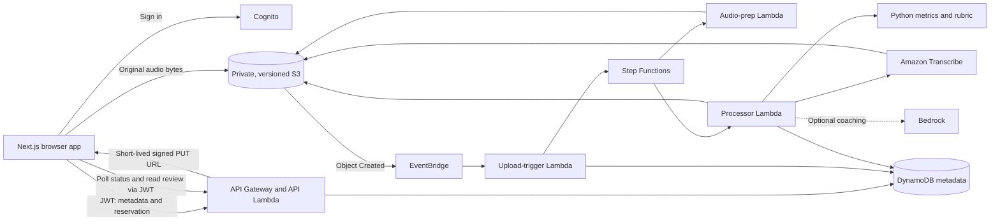

# SpeakUp design overview

SpeakUp helps people review public-speaking recordings. It keeps the original
audio, prepares a separate analysis copy, transcribes speech, measures pace,
fillers, and pauses, and presents timestamped results and coaching feedback.
This document explains the architecture and its main design choices. The
[pipeline walkthrough](full-pipeline-walkthrough.md) covers runtime details;
[API contracts](aws-payload-api.md) and [deployment instructions](../infra/README.md)
cover the interfaces and infrastructure.

## Users and goals

A speaker can record in the browser or upload audio, inspect transcript-linked
metrics, and replay a relevant moment. Projects, recordings, and reviews must
remain scoped to their owner. A separate voice model has not been specified.

## System architecture

The deployed API validates a Cognito JWT and uses its subject as the owner ID;
the browser cannot choose another owner in a request. Local fixture mode does
not contact AWS. A development-only guest bridge can exercise the backend
without exposing AWS credentials to browser code; it is disabled in production.
See [frontend modes](../frontend/web/README.md) and the
[pipeline walkthrough](full-pipeline-walkthrough.md#current-scope).

### Recording workflow

1. **Capture and reserve.** The browser records or selects audio locally. On
   **Start presentation with audio**, it creates a project if needed, calculates
   the file's SHA-256 and length, and calls `POST /uploads`. The API reserves an
   owner-scoped recording and returns a short-lived, checksum-bound S3 PUT URL.
2. **Upload and admit.** The browser sends the unchanged original directly to
   private S3. An S3 object event reaches the upload-trigger Lambda through
   EventBridge. It checks the reservation, object size, type, checksum, and
   scope before starting a deterministic workflow execution. Duplicate events
   or repeated requests do not start a second analysis for that recording.
3. **Prepare and transcribe.** Step Functions invokes audio preparation, which
   writes separate versioned WAV artifacts and a quality report without
   replacing the original. The processor starts or reuses an Amazon Transcribe
   job and polls with bounded waits and retries.
4. **Analyze and coach.** The processor normalizes timed transcript words,
   computes speech measures in Python, and applies the versioned rubric CSV.
   Optional Bedrock coaching uses persisted measurements as evidence; it does
   not calculate or replace scores. The workflow records terminal success or
   failure.
5. **Review.** The browser polls recording status, then requests the
   owner-checked review. The API reads private transcript, analysis, and
   optional feedback artifacts and returns public fields without internal S3
   keys or workflow identifiers.

The recording form keeps microphone capture, countdown, preview, and retakes
local until submission. Browser speech recognition provides a provisional live
transcript and pace estimate; it may process speech through a browser vendor.
Filler words appear as ordinary text in the live transcript. Filler scores and
highlights belong to the completed review, which uses the submitted audio and
timed Transcribe words. The retake confirmation preference is browser
`localStorage`, not an account setting.

## Data and scoring

| Store | Contents | Access pattern |
| --- | --- | --- |
| DynamoDB | Owner-scoped projects and recordings, lifecycle state, compact summary metrics, and artifact references | Lists, status polling, and revision-guarded updates |
| Private S3 | Original and prepared audio, raw and normalized transcripts, detailed analysis, and optional feedback | Versioned artifacts read by the workflow or owner-checked API routes |

Step Functions passes IDs and object keys between stages instead of audio or
transcript contents. Recording revisions guard concurrent state changes, while
versioned artifact keys let a replay retain earlier results. The original
remains available even if preparation or a later stage fails. See the
[storage layout and lifecycle](full-pipeline-walkthrough.md#core-design-rule).

The active [rubric CSV](../src/scoring/rubrics/speaking-2026-10-31.csv) defines
eligibility and score bands. Python derives pace, scored fillers per 100 spoken
words, and inside-sentence pauses per speaking minute from timed words and
audio-preparation pause inputs, falling back to transcript gaps when acoustic
inputs are missing. Scores are deterministic; optional coaching text must stay
grounded in those measurements.

## Design rationale and tradeoffs

| Decision | Why this design | Cost or limitation |
| --- | --- | --- |
| Keep metadata in DynamoDB and large artifacts in S3 | Status and lists stay compact while audio and detailed JSON use object storage. | The API and workflow must manage artifact references and versions. |
| Upload directly to S3 with a signed URL | Audio avoids API Gateway payload limits and an unnecessary Lambda transfer. The browser receives no permanent AWS credentials. | A URL is usable by its holder until expiry; the reservation, signed headers, and checksum need validation. |
| Start work from an object event and coordinate it with Step Functions | Processing begins after the object exists; bounded retries, polling, and terminal states cover long-running stages. | Duplicate events and retries require deterministic execution names, hash claims, and recording revisions. |
| Preserve original audio and write prepared versions | Users can download the original and analysis can be replayed with a different preparation version. | Separate artifacts use additional storage. |
| Use Amazon Transcribe, deterministic scoring, and optional Bedrock coaching | In the team's small comparison, Transcribe captured more scored fillers than the tested Whisper setups; Python and the rubric keep scores reproducible even when coaching is unavailable. | Transcribe and Bedrock process content through AWS. The comparison is limited, and model feedback is not a source of measured scores. |

The [Transcribe comparison](research/TRANSCRIPTION_MODEL_CHOICE.md) records
measured recall, cost assumptions, privacy tradeoffs, and test-set limits. The
[pipeline walkthrough](full-pipeline-walkthrough.md) documents the upload,
retry, and replay behavior behind the other choices.

## Security and risks

The API requires a JWT for non-health routes and checks ownership on project,
recording, download, and review operations. The S3 bucket is private; uploads
and playback use short-lived signed URLs. Workflow logs omit execution
payloads, and application code must not log audio bytes, transcript text,
credentials, or signed URLs. The
[infrastructure security checks](../infra/README.md#development-security-check-2026-11-20)
record observed development controls and evidence limits. Template settings
alone do not establish deployed or production security.

| Risk | Current control or mitigation | Evidence gap or next action |
| --- | --- | --- |
| A user reads another user's recording | JWT subject and owner-scoped API reads; internal keys are not returned in public responses. | Run authenticated two-user checks against the deployed API. |
| A signed URL leaks or is reused | URLs expire after 15 minutes; upload headers bind type and checksum, and downloads require an owner check before signing. | Test upload/download boundaries and expiry; never log or persist URLs. |
| Audio or transcripts reach unintended services or logs | S3 is private; workflow logs omit payloads; browser live recognition and AWS Transcribe/Bedrock are identified processing boundaries. | Explain third-party processing to users and verify the proposed Transcribe opt-out; audit log content without printing user data. |
| Deployed permissions differ from intended IAM policy | Roles and bucket policy are defined in CloudFormation. | The November 20 IAM simulation reported an Organizations explicit deny; effective runtime permission remains unverified. |
| Production sign-in weakens required MFA | Production configuration requires TOTP and currently refuses Google sign-in because that path skips it. | Define and verify an MFA policy for Google users before enabling production Google sign-in. |
| A deleted Cognito domain remains a Google redirect | Deployment instructions require removing its redirect URI before stack deletion. | Include that cleanup in any future stack removal; the domain can be reclaimed. |
| Retained or deleted recordings persist longer than expected | Stateful resources are retained on stack deletion; lifecycle and purge behavior are documented separately. | Verify retention and permanent version purge in the deployed environment before promising deletion timing. |

## Validation and rollout

Run backend tests with
`python -m pytest -q --basetemp .test-tmp -p no:cacheprovider`. Run frontend
checks from `frontend/web/` with `npm run lint` and `npm run test:all`.
Local tests and template checks do not prove a deployed workflow or policy
posture. The [infrastructure README](../infra/README.md#remaining-security-checks)
tracks dated development checks and remaining authenticated, read-only, and
production checks. Authenticated browser-to-backend validation, the
Organizations IAM deny, and production security review remain open.
