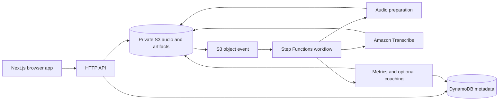

# SpeakUp design overview

SpeakUp helps people review public-speaking recordings. It keeps the original
audio, prepares a separate analysis copy, transcribes speech, measures pace,
fillers, and pauses, and presents timestamped results and coaching feedback.
This document describes the current design; API details live in
[aws-payload-api.md](aws-payload-api.md) and deployment details in
[../infra/README.md](../infra/README.md).

## Users and goals

The intended user is a speaker reviewing a recorded presentation. The core
workflow is to upload a recording, start processing, inspect transcript-linked
metrics, and replay audio at a relevant moment. The system must keep one user's
projects and recordings separate from another user's data. A separate voice
model has not been specified.

## System architecture

The API issues a signed upload reservation. The S3 object event normally
confirms the uploaded object and starts processing. The workflow prepares a
separate audio artifact, obtains a
timestamped transcript, and writes versioned analysis results. The original
recording is not overwritten. The browser can use sample data locally or a
development API bridge. Production sign-in and a deployed browser-to-backend
smoke test remain open work.

The recording form keeps microphone capture, countdown, preview, and retakes
local until **Start presentation with audio**. In live mode, that action creates
a project if needed and uploads the selected audio. Loading existing projects
and limits still uses read-only API calls before submission. The live transcript
and provisional filler and pace estimates use browser speech recognition,
which may process speech through a browser vendor; backend rubric scores use
the submitted audio and its timed transcript. The retake confirmation preference
is browser `localStorage`, not an account setting.

## Data and scoring

Private S3 objects hold recordings and large JSON artifacts. DynamoDB holds
owner-scoped metadata, lifecycle state, compact references, and summary
metrics. The active rubric CSV at
[`src/scoring/rubrics/speaking-2026-10-31.csv`](../src/scoring/rubrics/speaking-2026-10-31.csv)
defines score bands. The processor derives pace, scored filler rate, and
inside-sentence pause rate from timestamped words and audio-preparation pause
inputs. [Research notes](research/README.md) explain the evidence and limits
behind these choices. Coaching feedback is optional and must remain grounded
in persisted metrics and the matching rubric.

## Security and reliability

The API checks ownership on project and recording operations. Uploads and
playback use short-lived signed URLs; the underlying buckets are private.
Workflow stages are designed for replay, with bounded polling and terminal
failure recording. Active workflows cannot be soft-deleted. Deployed IAM,
storage policy, retention, and end-to-end behavior still require validation.

## Validation and rollout

Run backend tests with
`python -m pytest -q --basetemp .test-tmp -p no:cacheprovider`. Run frontend
checks from `frontend/web/` with `npm run lint` and `npm run test:all`.
These local checks do not prove a deployed workflow. A development stack
exists, but the current code still needs an authenticated end-to-end check
there. Index migration, production sign-in, and a production security review
remain open.
