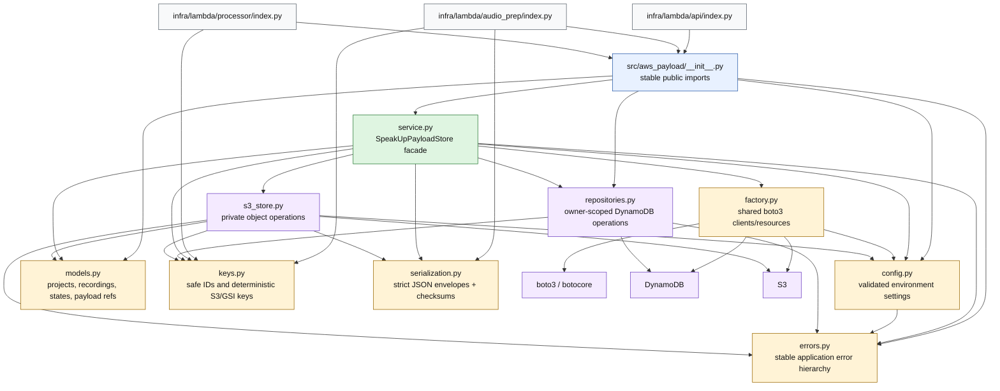
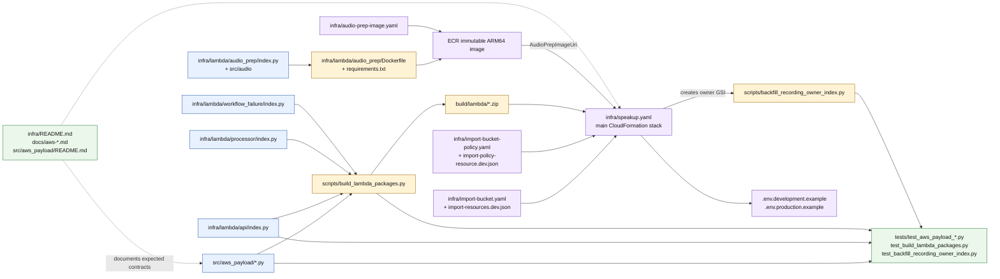

# SpeakUp AWS API file flowchart

This is an editable, diagram-as-code map of the SpeakUp AWS backend. GitHub and
Mermaid-compatible Markdown previewers render the fenced `mermaid` blocks as
flowcharts; the source remains searchable plain text and no image is generated.

## 1. Runtime request and processing flow

```mermaid
flowchart LR
    classDef entry fill:#e8f1ff,stroke:#2457a7,color:#111;
    classDef adapter fill:#fff3d6,stroke:#9a6700,color:#111;
    classDef core fill:#eaf7ea,stroke:#277a34,color:#111;
    classDef aws fill:#f4eaff,stroke:#6f42c1,color:#111;
    classDef observe fill:#f8f9fa,stroke:#57606a,color:#111;

    Browser["Frontend / API client"]:::entry
    Cognito["Amazon Cognito<br/>authentication + JWT"]:::aws
    Gateway["API Gateway HTTP API<br/>routes + JWT authorizer"]:::aws
    ApiLambda["infra/lambda/api/index.py<br/>HTTP routing, validation, responses"]:::adapter
    Store["src/aws_payload/service.py<br/>owner-checking application facade"]:::core
    Repos["src/aws_payload/repositories.py<br/>project + recording persistence"]:::core
    S3Store["src/aws_payload/s3_store.py<br/>presigned URLs + artifacts + purge"]:::core
    DynamoDB["DynamoDB<br/>projects + recordings"]:::aws
    S3["Private S3 bucket<br/>audio + versioned artifacts"]:::aws
    Workflow["Step Functions<br/>processing state machine"]:::aws
    PrepLambda["infra/lambda/audio_prep/index.py<br/>prepare audio + write artifacts"]:::adapter
    Processor["infra/lambda/processor/index.py<br/>Transcribe + metrics + Bedrock adapter"]:::adapter
    UploadTrigger["index.upload_handler<br/>validate upload + idempotent start"]:::adapter
    Transcribe["Amazon Transcribe"]:::aws
    Bedrock["Amazon Bedrock"]:::aws
    EventBridge["EventBridge<br/>original uploads + terminal failures"]:::aws
    FailureLambda["infra/lambda/workflow_failure/index.py<br/>safe failure logging"]:::adapter
    Logs["CloudWatch Logs / X-Ray"]:::observe

    Browser -->|"sign up / sign in"| Cognito
    Cognito -->|"signed JWT"| Browser
    Browser -->|"HTTP request + JWT"| Gateway
    Gateway -->|"authorized event"| ApiLambda
    ApiLambda --> Store
    Store --> Repos
    Repos --> DynamoDB
    Store --> S3Store
    S3Store -->|"presigned PUT/GET"| Browser
    Browser -->|"direct audio upload"| S3
    S3Store --> S3
    S3 -->|"Object Created: original audio"| EventBridge
    EventBridge --> UploadTrigger
    UploadTrigger --> Store
    UploadTrigger -->|"start processing"| Workflow
    ApiLambda -.->|"idempotent recovery start"| Workflow
    Workflow -->|"1. preprocess"| PrepLambda
    PrepLambda --> Store
    PrepLambda -->|"prepared audio + report"| S3
    Workflow -->|"2. start / poll / analyze / coach"| Processor
    Processor --> Transcribe
    Transcribe -->|"job status + transcript"| Processor
    Processor --> Bedrock
    Bedrock -->|"coaching response"| Processor
    Processor --> Store
    Workflow -.->|"failed execution"| EventBridge
    EventBridge --> FailureLambda
    ApiLambda -.-> Logs
    UploadTrigger -.-> Logs
    PrepLambda -.-> Logs
    Processor -.-> Logs
    Workflow -.-> Logs
    FailureLambda -.-> Logs
```

### Reading the runtime flow

- The client never receives permanent AWS credentials.
- API Gateway validates Cognito JWTs before protected requests reach the API
  Lambda.
- The API Lambda calls one high-level Python facade instead of using S3 and
  DynamoDB directly.
- Audio moves directly between the browser and private S3 using short-lived,
  owner-scoped presigned URLs.
- The original-object event automatically confirms the reservation and starts
  one deterministic workflow execution; duplicate delivery is safe.
- Step Functions, not the HTTP request, owns long-running processing.
- The processor file is an AWS integration adapter. The analytics formulas can
  change without changing the surrounding infrastructure flow.

## 2. Python API file dependency flow

## 3. Deployment, packaging, documentation, and test flow

## File-by-file relevance

### Infrastructure and deployment files

| File | What it does | Why it matters |
|---|---|---|
| `infra/speakup.yaml` | Defines S3, DynamoDB, Cognito, API Gateway, IAM, Lambda, Step Functions, EventBridge, CloudWatch, routes, and outputs. | Source of truth for the deployed backend topology and security boundaries. |
| `infra/audio-prep-image.yaml` | Creates the encrypted, scan-on-push ECR repository with immutable tags. | Supplies the native-dependency container image used by the audio-prep Lambda. |
| `infra/import-bucket.yaml` | Temporary CloudFormation bridge for adopting the existing development bucket. | Preserves existing objects while bringing the bucket under stack management. |
| `infra/import-bucket-policy.yaml` | Adds the retained HTTPS-only policy during bucket adoption. | Makes the imported bucket reject non-TLS access. |
| `infra/import-resources.dev.json` | Identifies the existing bucket for CloudFormation resource import. | Connects the physical development bucket to the `DataBucket` logical resource. |
| `infra/import-policy-resource.dev.json` | Identifies the existing bucket policy for resource import. | Connects the physical policy to the `DataBucketPolicy` logical resource. |
| `.env.development.example` | Documents non-secret development resource identifiers and client configuration. | Lets local/frontend code target the development stack without storing credentials. |
| `.env.production.example` | Defines the production configuration schema without pointing at development. | Prevents accidental reuse of development resources in production. |

### Lambda adapter files

| File | What it does | Why it matters |
|---|---|---|
| `infra/lambda/api/index.py` | Parses API Gateway events, reads the Cognito subject, dispatches routes, validates input, maps domain errors to HTTP responses, and starts Step Functions. | This is the public HTTP boundary; it prevents callers from bypassing ownership and storage rules. |
| `infra/lambda/audio_prep/index.py` | Validates recording scope, downloads the original, runs audio preparation, and stores prepared audio and its report. | Adapts the reusable audio library to S3 and Step Functions. |
| `infra/lambda/processor/index.py` | Starts/polls Transcribe, stores transcript/analysis artifacts, invokes Bedrock, and advances recording state. | Connects the workflow to managed AI services; metric implementation details are replaceable. |
| `infra/lambda/workflow_failure/index.py` | Receives terminal workflow failures and logs a small, safe diagnostic event. | Gives operations a failure signal without copying transcripts or audio into logs. |
| `infra/lambda/audio_prep/Dockerfile` | Builds the Lambda-compatible Python container and copies the adapter plus source packages. | Packages native audio dependencies that are unsuitable for the zip Lambdas. |
| `infra/lambda/audio_prep/requirements.txt` | Pins the audio-preparation container dependencies. | Makes the container build reproducible. |

### Internal AWS payload API files

| File | What it does | Why it matters |
|---|---|---|
| `src/aws_payload/__init__.py` | Re-exports the supported classes, models, and errors. | Gives Lambda adapters one stable import surface. |
| `src/aws_payload/config.py` | Loads and validates region, bucket, table, TTL, retention, payload-size, retry, and timeout settings. | Fails before AWS calls when deployment configuration is unsafe or incomplete. |
| `src/aws_payload/errors.py` | Defines configuration, validation, ownership, integrity, conflict, not-found, and availability errors. | Keeps HTTP error mapping and workflow retry behavior predictable. |
| `src/aws_payload/factory.py` | Creates and reuses configured boto3 S3 clients and DynamoDB resources. | Centralizes retries, timeouts, pooling, SigV4, and the normal AWS credential chain. |
| `src/aws_payload/keys.py` | Validates identifiers and builds deterministic recording, artifact, legacy, and GSI keys. | Stops path traversal and prevents callers from selecting arbitrary storage locations. |
| `src/aws_payload/models.py` | Defines projects, recordings, lifecycle states, payload types/references, and upload intents. | Establishes the data contract shared by HTTP, workflows, S3, and DynamoDB. |
| `src/aws_payload/repositories.py` | Implements conditional owner-scoped project/recording reads and writes, pagination, transitions, recovery, and deletion staging. | Enforces DynamoDB isolation, concurrency, and lifecycle correctness. |
| `src/aws_payload/s3_store.py` | Creates presigned uploads/downloads, confirms objects, stores/reads versioned artifacts, streams files, and purges recording versions. | Enforces private S3 access, encryption metadata, integrity, and recording-prefix boundaries. |
| `src/aws_payload/serialization.py` | Canonically encodes strict JSON, rejects unsafe values, wraps payload envelopes, and validates size/type/checksum metadata. | Makes stored artifacts deterministic and detects corruption or contract mismatches. |
| `src/aws_payload/service.py` | Provides `SpeakUpPayloadStore`, coordinating repositories and S3 into owner-checked operations. | This is the application-facing facade used by every Lambda adapter. |

### Packaging and migration scripts

| File | What it does | Why it matters |
|---|---|---|
| `scripts/build_lambda_packages.py` | Builds the API, processor, and workflow-failure zip artifacts with shared source code. | Produces the immutable objects referenced by the main stack. |
| `scripts/backfill_recording_owner_index.py` | Finds legacy recording rows and optionally adds the owner-scoped GSI fields. | Migrates old data without requiring a table scan in normal API traffic. |

### AWS API documentation

| File | What it covers |
|---|---|
| `infra/README.md` | Deployment defaults, routes, packaging, image build, costs, limitation, validation, and cleanup. |
| `docs/aws-high-level-functionality.md` | Capability-level checklist for storage, ownership, lifecycle, integrity, and retries. |
| `docs/aws-payload-api.md` | HTTP route contract, error model, payload example, GSI migration, and validation. |
| `docs/aws-payload-dynamodb.md` | DynamoDB key shapes, indexes, lifecycle metadata, concurrency, and deletion behavior. |
| `docs/aws-payload-s3.md` | S3 layout, upload/download rules, artifacts, integrity, and cleanup. |
| `docs/aws-payload-package-reference.md` | Function-level reference for the internal Python package. |
| `docs/aws-payload-api-implementation-plan.md` | Historical implementation sequence and design decisions. |
| `src/aws_payload/README.md` | Concise developer-facing package overview and examples. |

### Verification files

| Test file | Main responsibility covered |
|---|---|
| `tests/test_aws_payload_api_handler.py` | API Gateway routing, identity handling, validation, HTTP responses, and workflow start behavior. |
| `tests/test_aws_payload_foundation.py` | Configuration, identifiers, keys, strict serialization, envelopes, and foundational errors. |
| `tests/test_aws_payload_repositories.py` | Owner-scoped queries, pagination, conditional writes, transitions, concurrency, recovery, and deletion staging. |
| `tests/test_aws_payload_s3.py` | Presigned requests, object confirmation, immutable artifacts, integrity checks, downloads, and purge behavior. |
| `tests/test_aws_payload_moto.py` | S3 behavior against an in-memory AWS-compatible mock. |
| `tests/test_build_lambda_packages.py` | Zip packaging contents and path layout. |
| `tests/test_backfill_recording_owner_index.py` | Legacy-row index-key calculation used by the migration script. |

## Scope boundary

The AWS API boundary ends at the Lambda adapters and `src/aws_payload` package.
`src/audio` owns audio preparation algorithms, while future analytics modules can
own scoring formulas. Those implementation details feed the workflow but do not
change the API Gateway, Cognito, S3, DynamoDB, or Step Functions architecture.

