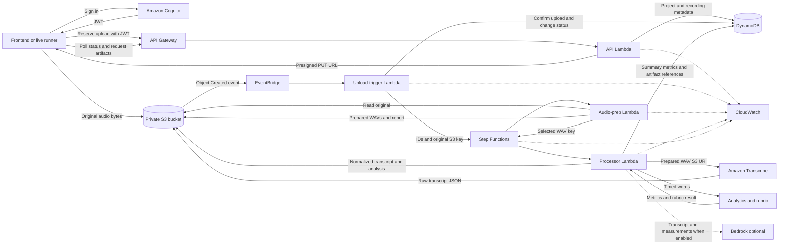

# SpeakUp full pipeline walkthrough

This document explains how one recording moves through SpeakUp, which files
participate, what each stage sends to the next stage, and where the resulting
data is stored.

## Current scope

The backend pipeline is connected and has been exercised end to end with a real
48 kHz recording. The `frontend/` directory currently contains sample payloads
and integration contracts, not James's frontend application source. The live
pipeline runner performs the same reservation, upload, and polling calls that
the frontend needs to implement.

Bedrock feedback is currently disabled. A recording still proceeds through
upload, audio preparation, Amazon Transcribe, deterministic analytics, rubric
evaluation, and completion.

## Architecture at a glance



## Core design rule

SpeakUp separates small, frequently read metadata from large artifacts:

- DynamoDB stores projects, recording lifecycle state, summary metrics, and
  compact references to artifacts.
- S3 stores original audio, prepared audio, preprocessing reports, raw and
  normalized transcripts, detailed speech analysis, and optional feedback.
- Step Functions passes identifiers and S3 keys between stages instead of
  copying audio or transcript contents through workflow state.
- CloudWatch stores operational logs and timings. Audio bytes, transcript text,
  credentials, and presigned URLs must not be logged.

## Recording lifecycle

The normal successful lifecycle is:

```text
AWAITING_UPLOAD
    -> UPLOADED
    -> PROCESSING
    -> TRANSCRIBING
    -> ANALYZED
    -> COMPLETE
```

`FAILED`, `DELETED`, and `PURGE_PENDING` support error handling and deletion.
Every mutation uses a recording revision so concurrent workers cannot silently
overwrite each other.

## End-to-end sequence

### 1. Authenticate the user

Amazon Cognito is declared in `infra/speakup.yaml`. It authenticates the user
and returns a JWT. The frontend includes that token in protected API calls:

```http
Authorization: Bearer <JWT>
```

API Gateway validates the token before invoking the API Lambda. The Cognito
`sub` claim becomes `user_id`. Request bodies cannot choose another owner's ID.

### 2. Create or select a project

The frontend creates a project with `POST /projects` or selects an existing one
from `GET /projects`.

`infra/lambda/api/index.py` handles the HTTP request and calls
`SpeakUpPayloadStore.create_project()` in `src/aws_payload/service.py`. The
service writes an owner-scoped item to the projects DynamoDB table through
`ProjectRepository` in `src/aws_payload/repositories.py`.

### 3. Reserve an upload

The frontend calls `POST /uploads` with data similar to:

```json
{
  "project_id": "4039d0ae-1bcf-4d3d-a0af-385ceffcf18b",
  "content_type": "audio/mp4",
  "content_length": 1084626,
  "sha256": "<Base64 SHA-256>",
  "idempotency_key": "<client retry key>"
}
```

`infra/lambda/api/index.py`:

1. Extracts the authenticated user from the API Gateway event.
2. Validates the body and checksum.
3. Checks whether identical audio already exists in that project.
4. Derives a deterministic recording ID from the owner, project, and
   idempotency key.
5. Calls `SpeakUpPayloadStore.reserve_upload()`.

`src/aws_payload/service.py` coordinates two operations:

1. It creates an `AWAITING_UPLOAD` recording row through
   `RecordingRepository`.
2. It asks `S3PayloadStore` to create a short-lived presigned PUT URL.

The response sent back to the frontend contains:

```json
{
  "recording_id": "...",
  "object_key": "users/.../original.m4a",
  "upload_url": "<short-lived signed URL>",
  "required_headers": {
    "Content-Type": "audio/mp4",
    "x-amz-checksum-sha256": "..."
  },
  "expected_content_length": 1084626
}
```

The frontend receives permission for one specific upload. It never receives
permanent AWS credentials.

### 4. Upload the original directly to S3

The frontend sends an HTTP PUT to `upload_url` using the returned headers and
the unchanged audio bytes.

The audio does not pass through API Gateway or Lambda. It goes directly into the
private S3 bucket at:

```text
users/{user_id}/projects/{project_id}/recordings/{recording_id}/original.{ext}
```

This avoids API Gateway payload limits and unnecessary Lambda transfer costs.

### 5. Start processing automatically

S3 publishes an `Object Created` event through EventBridge. The
`UploadCompletedRule` in `infra/speakup.yaml` only matches the SpeakUp bucket
and approved original-audio suffixes.

EventBridge invokes `upload_handler()` in `infra/lambda/api/index.py`. The event
contains bucket and object metadata, not the audio bytes.

The upload handler:

1. Validates that the event came from the expected bucket.
2. Parses the owner, project, and recording IDs from the exact key structure.
3. Confirms that the S3 object's length, content type, checksum, and scope match
   the reservation.
4. Claims the recording hash so an identical project recording cannot start a
   second workflow.
5. Changes the status to `PROCESSING`.
6. Starts a deterministic Step Functions execution.

The Step Functions input is intentionally small:

```json
{
  "user_id": "...",
  "project_id": "...",
  "recording_id": "...",
  "audio_s3_key": "users/.../original.m4a"
}
```

Duplicate S3 events are safe. The stable recording revision, hash claim, and
Step Functions execution name make the start idempotent.

### 6. Coordinate the workflow

The `ProcessingStateMachine` definition lives in `infra/speakup.yaml`:

```text
PreprocessAudio
    -> StartTranscription
    -> WaitForTranscribe
    -> CheckTranscription
    -> TranscriptionStatus
         -> WaitForTranscribe when still running
         -> MarkFailed on failure or polling exhaustion
         -> AnalyzeSpeech when complete
    -> GenerateFeedback
    -> Complete
```

Each task has bounded retries. The workflow passes only IDs, S3 keys, job names,
status values, and compact metrics.

### 7. Prepare the audio

Step Functions invokes `infra/lambda/audio_prep/index.py` with the recording
scope and original S3 key.

The adapter:

1. Reads the recording from DynamoDB and verifies the project and original key.
2. Checks whether an identical versioned preprocessing result already exists.
3. Downloads the original into temporary Lambda storage.
4. Calls `process_audio_file()` in `src/audio/preprocess.py`.
5. Uploads the output WAVs and report to S3.
6. Adds their compact references to the recording row.
7. Returns the selected transcription-audio S3 key to Step Functions.

The reusable audio modules divide the work as follows:

| File | Responsibility |
| --- | --- |
| `src/audio/config.py` | Validated limits, target sample rate, enhancement settings, configuration fingerprint, and artifact version. |
| `src/audio/io.py` | Bounded decoding of supported containers and writing PCM WAV output. |
| `src/audio/enhancement.py` | DeepFilterNet loading and speech enhancement. |
| `src/audio/filters.py` | Resampling, speech-level normalization, blending, and optional compatibility filters. |
| `src/audio/quality.py` | Signal measurements, warnings, and distortion comparisons. |
| `src/audio/preprocess.py` | Coordinates decoding, normalization, model enhancement, fallback selection, output writing, and report generation. |

The stage writes:

```text
reference.wav
enhanced_model.wav
enhanced_blended.wav
diagnostic.wav
report.json
```

The model candidate is used only when it passes the distortion gate. Otherwise,
the stage selects the conservative blend or normalized reference. The selected
`diagnostic.wav` becomes the Transcribe input.

### 8. Start and poll Amazon Transcribe

Step Functions invokes `infra/lambda/processor/index.py` with `action: "start"`
and the selected prepared-audio key.

The processor:

1. Builds a deterministic Transcribe job name.
2. Supplies an S3 URI for the prepared WAV.
3. Supplies a versioned S3 output key for raw transcript JSON.
4. Starts or safely rejoins the Transcribe job.
5. Changes the recording to `TRANSCRIBING`.
6. Returns the job name, output key, and poll count to Step Functions.

Step Functions waits 15 seconds, then invokes the same processor with
`action: "status"`. The processor calls `GetTranscriptionJob` and returns:

```json
{
  "transcribe_status": "IN_PROGRESS",
  "poll_attempts": 1,
  "error": ""
}
```

The state machine loops until Transcribe returns `COMPLETED`, `FAILED`, or the
bounded poll count is exhausted.

### 9. Normalize the transcript and calculate analytics

After completion, Step Functions invokes the processor with
`action: "analyze"`.

The processor reads the raw Transcribe JSON from S3. The document supplies:

- complete transcript text;
- pronunciation items with word start and end timestamps; and
- punctuation items used to estimate sentence boundaries.

The processor passes the timed items to `score_transcribe_items()` in
`src/scoring/rubric.py`.

That function calculates:

- transcribed and scored word counts;
- words per minute;
- scored filler counts and occurrence timestamps;
- fillers per 100 spoken words;
- unscored watch words;
- word-gap pauses of at least 0.3 seconds;
- inside-sentence and between-sentence pause counts;
- pause timestamps and durations;
- pauses per speaking minute;
- long-pause flags; and
- estimated speaking duration.

`src/scoring/rubric_definition.py` loads and validates
`src/scoring/rubrics/speaking-2026-10-31.csv`. The Python code defines how to
measure speech. The CSV defines eligibility and maps the calculated values to
scores from 0 through 4.

The current code considers a recording eligible only when estimated speaking
time after detected pauses is at least 60 seconds. This is stricter than merely
requiring a 60-second recording and should be reviewed against the intended
product rule.

The processor stores two versioned JSON artifacts in S3:

```text
transcript.json
speech_analysis.json
```

It writes compact summary metrics and the artifact references to the DynamoDB
recording, then changes its status to `ANALYZED`.

### 10. Generate or skip coaching feedback

Step Functions invokes the processor with `action: "feedback"`.

When `ENABLE_BEDROCK_FEEDBACK=false`, the processor:

1. Verifies that deterministic analysis exists.
2. Logs that feedback was skipped.
3. Changes the recording to `COMPLETE`.

When enabled, it would read the normalized transcript, combine it with the
calculated measurements, invoke the configured Bedrock model, store
`feedback.json` in S3, attach its reference, and then mark the recording
`COMPLETE`.

Bedrock is never allowed to invent the deterministic measurements. It receives
the calculator results as evidence and writes coaching text around them.

### 11. Return results to the frontend

The frontend polls:

```http
GET /recordings/{recordingId}
```

This returns lifecycle status and compact summary metrics. For complete data,
the frontend calls:

```http
GET /recordings/{recordingId}/artifacts/transcript
GET /recordings/{recordingId}/artifacts/analysis
GET /recordings/{recordingId}/artifacts/feedback
```

The API verifies ownership, resolves the stored reference, reads the private S3
artifact, and returns a public response. It does not expose raw S3 references,
Step Functions ARNs, Transcribe job names, or Bedrock model identifiers.

## Runtime file map

### Infrastructure and AWS wiring

| File | Responsibility | Sends or connects to |
| --- | --- | --- |
| `infra/speakup.yaml` | Defines S3, DynamoDB, Cognito, API Gateway, IAM, Lambda, Step Functions, EventBridge, SQS, logs, alarms, routes, and stack outputs. | Creates and connects the deployed AWS resources. |
| `infra/audio-prep-image.yaml` | Defines the immutable, scan-on-push ECR repository. | Supplies the repository used by the audio-prep Lambda image. |
| `infra/import-bucket.yaml` | CloudFormation import bridge for the pre-existing development bucket. | Used during deployment only. |
| `infra/import-bucket-policy.yaml` | Imports the retained TLS-only bucket policy. | Used during deployment only. |
| `infra/import-resources.dev.json` | Identifies the physical bucket during import. | CloudFormation import input. |
| `infra/import-policy-resource.dev.json` | Identifies the physical bucket policy during import. | CloudFormation import input. |

### Lambda adapters

| File | Responsibility | Sends or connects to |
| --- | --- | --- |
| `infra/lambda/api/index.py` | Public HTTP routing, Cognito identity extraction, request validation, safe responses, duplicate checks, upload-trigger handling, and workflow start. | Calls `SpeakUpPayloadStore` and Step Functions. |
| `infra/lambda/audio_prep/index.py` | AWS adapter around reusable audio preparation. | Reads DynamoDB and S3, calls `src/audio`, then writes artifacts and references. |
| `infra/lambda/processor/index.py` | Starts and polls Transcribe, normalizes transcripts, invokes scoring, optionally calls Bedrock, and advances lifecycle state. | Calls Transcribe, Bedrock, `src/scoring`, S3, and DynamoDB. |
| `infra/lambda/workflow_failure/index.py` | Handles terminal workflow failures and repairs stale workflow metadata. | Reads Step Functions status and updates DynamoDB. |
| `infra/lambda/retention_cleanup/index.py` | Purges expired abandoned, failed, or deleted recordings in bounded batches. | Reads the maintenance index, deletes S3 versions, and finalizes DynamoDB deletion. |
| `infra/lambda/audio_prep/Dockerfile` | Packages FFmpeg, native audio dependencies, the model, adapter, and reusable source. | Produces the image used by the audio-prep Lambda. |
| `infra/lambda/audio_prep/requirements.txt` | Pins container-only audio dependencies. | Installed by the Docker image build. |

### Shared AWS payload package

| File | Responsibility | Used by |
| --- | --- | --- |
| `src/aws_payload/__init__.py` | Stable public import surface. | Lambda adapters. |
| `src/aws_payload/service.py` | Application facade coordinating ownership, S3, DynamoDB, lifecycle, and artifacts. | API, upload trigger, audio prep, processor, failure, and maintenance Lambdas. |
| `src/aws_payload/repositories.py` | Conditional project and recording operations, revisions, indexes, pagination, admissions, deletion, and recovery. | `service.py`, backed by DynamoDB. |
| `src/aws_payload/s3_store.py` | Presigned URLs, original confirmation, artifact writes and reads, streaming, downloads, and version purge. | `service.py`, backed by S3. |
| `src/aws_payload/models.py` | Project, recording, upload-intent, payload-reference, payload-type, and lifecycle models. | All storage and Lambda layers. |
| `src/aws_payload/keys.py` | Identifier validation and the only approved constructors for recording and artifact keys. | API, audio prep, processor, service, and S3 adapter. |
| `src/aws_payload/serialization.py` | Canonical JSON, strict parsing, versioned envelopes, payload validation, and size limits. | Artifact writers and readers. |
| `src/aws_payload/checksum.py` | Normalizes Base64 SHA-256 values into a canonical representation. | API duplicate and integrity checks. |
| `src/aws_payload/config.py` | Validates environment resource names, limits, TTLs, retries, and timeouts. | `SpeakUpPayloadStore.from_environment()`. |
| `src/aws_payload/factory.py` | Creates and reuses configured boto3 S3 clients and DynamoDB resources. | Storage package. |
| `src/aws_payload/errors.py` | Stable validation, ownership, conflict, integrity, availability, and limit errors. | Storage package and HTTP error mapping. |
| `src/aws_payload/policy.py` | Shared definition of active workflow statuses. | API and storage logic. |

### Scoring package

| File | Responsibility | Sends or connects to |
| --- | --- | --- |
| `src/scoring/rubric.py` | Converts Transcribe timed items into measurements and optional rubric scores. | Called by the processor; returns the complete metrics dictionary. |
| `src/scoring/rubric_definition.py` | Loads and validates modular score bands and eligibility from CSV. | Called by `rubric.py`. |
| `src/scoring/rubrics/speaking-2026-10-31.csv` | Versioned 0-4 score bands and eligibility threshold. | Loaded by `rubric_definition.py`. |
| `src/scoring/transcript.py` | Extracts timed item collections from supported transcript document shapes. | Used by local scripts and tests; the deployed processor currently reads the AWS shape directly. |
| `src/scoring/__init__.py` | Stable scoring imports. | Processor and scripts. |

## Frontend contract files

The files under `frontend/sample-payloads/` are examples, not executable
frontend code:

| File | Contract represented |
| --- | --- |
| `upload-reservation.json` | `POST /uploads` success response. |
| `projects.json` | Project-list response. |
| `project-recordings.json` | Recording-list response. |
| `transcript.json` | Public transcript artifact response. |
| `analysis.json` | Public analysis artifact response. |
| `feedback.json` | Public feedback artifact response. |
| `account-limits.json` | Current upload and active-workflow limits. |
| `active-workflow-limit-error.json` | HTTP 429 response when workflow capacity is exhausted. |

`frontend/README.md` explains how those payloads map to proposed screens.

## Local, testing, and operational scripts

These files help build, test, or inspect the pipeline but are not invoked for a
normal production recording:

| File | Purpose |
| --- | --- |
| `scripts/build_lambda_packages.py` | Builds ZIP packages for the API, processor, failure, and maintenance Lambdas. |
| `scripts/run_live_pipeline.py` | Simulates the frontend reservation, direct upload, polling, and result verification against deployed AWS. |
| `scripts/capture_live_pipeline_logs.py` | Captures Step Functions history and time-bounded CloudWatch logs without copying audio or transcript text. |
| `scripts/run_real_audio_qa.py` | Runs local audio-preparation QA across real clips. |
| `scripts/calculate_wpm.py` | Calculates WPM from a transcript on the command line. |
| `scripts/count_fillers.py` | Counts fillers from a transcript on the command line. |
| `scripts/check_transcript_accuracy.py` | Compares transcript output with reference text. |
| `scripts/transcribe_local.py` | Runs the local transcription adapter. |
| `scripts/backfill_recording_owner_index.py` | Adds owner-scoped index fields to legacy recording rows. |
| `scripts/backfill_maintenance_index.py` | Adds maintenance and admission metadata to legacy rows. |
| `scripts/create_audio_ab_example.py` | Creates audio comparison examples. |
| `scripts/generate_audio_prep_example.py` | Generates a preprocessing example. |
| `scripts/create_review_templates.py` | Generates review-oriented example material. |

Files under `tests/` validate units, adapters, storage behavior, workflow
definitions, replay safety, failure handling, and complete simulated or opt-in
live flows. AWS never executes the test files.

## Failure and retry behavior

- API requests return stable client-safe errors instead of raw AWS messages.
- Upload reservations and workflow starts are idempotent.
- Immutable artifacts accept an identical retry but reject different content at
  the same versioned key.
- Step Functions retries bounded transient task failures with backoff and jitter.
- Transcribe polling has a fixed upper bound.
- `MarkFailed` records a safe failure reason in DynamoDB.
- EventBridge observes failed, timed-out, and aborted workflow executions.
- The failure reconciler repairs recordings whose workflow ended without a
  matching terminal metadata state.
- Exhausted asynchronous events go to the shared dead-letter queue and raise a
  CloudWatch alarm.

## Storage result for one recording

After a successful deterministic run, AWS contains:

### DynamoDB projects table

- owner ID;
- project ID;
- title and description; and
- creation and update timestamps.

### DynamoDB recordings table

- owner, project, and recording IDs;
- content type and length;
- lifecycle and preprocessing status;
- revisions and workflow bookkeeping;
- compact summary metrics; and
- compact references to each artifact in S3.

### Private S3 prefix

```text
users/{user}/projects/{project}/recordings/{recording}/
  original.m4a
  artifacts/
    audio-prep/{version}/
      reference.wav
      enhanced_model.wav
      enhanced_blended.wav
      diagnostic.wav
      report.json
    aws-transcribe/{version}/
      transcript_raw.json
    speakup-transcript-normalizer/{version}/
      transcript.json
    speakup-speech-analysis/{version}/
      speech_analysis.json
    speakup-coach/{version}/
      feedback.json
```

`feedback.json` exists only when Bedrock feedback is enabled and succeeds.

## Related documentation

- `docs/aws-api-file-flowchart.md`: concise file and dependency diagrams.
- `docs/aws-payload-api.md`: HTTP routes and public response contracts.
- `docs/aws-payload-dynamodb.md`: table keys, indexes, lifecycle state, and
  concurrency rules.
- `docs/aws-payload-s3.md`: object layout, immutability, integrity, and cleanup.
- `docs/rubric-csv-format.md`: modular rubric CSV contract.
- `infra/README.md`: deployment, packaging, validation, costs, and operations.
- `src/aws_payload/README.md`: concise developer guide for the storage package.
