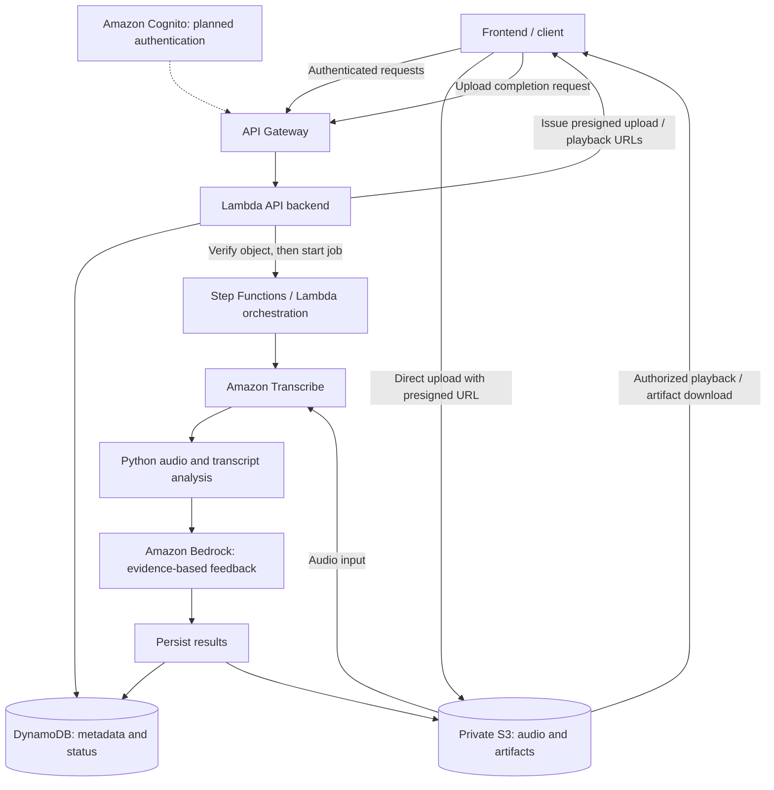

# Infrastructure

This folder is for deployment and cloud infrastructure configuration. Typical contents may include:

- AWS or GCP deployment scripts
- Terraform, CloudFormation, or Deployment Manager files
- service configuration for APIs, databases, and hosting
- instructions for provisioning and deploying the project

## SpeakUp AWS infrastructure

This guide describes the planned AWS system and common developer commands for project SpeakUp.

**Status: Draft.** The architecture, S3 object layout, DynamoDB tables, keys, and example records below are proposals for discussion. User and project data schemas have not yet been defined; the examples do not establish a finalized schema or API contract.

### Environment and implementation status

| Setting | Value | Status |
| --- | --- | --- |
| Shared project | SpeakUp | Project and credentials setup reported complete in team notes |
| Application region | `us-east-2` | Selected in setup notes |
| Local CLI profile | `speakup` | Each teammate configures their own profile and identity |
| Development audio bucket | `speakup-dev-audio-files` | Currently holds raw interview audio, as reported by the team; bucket configuration not independently verified here |
| Production bucket | Not finalized | Design notes propose `speakup-prod-private` |
| Backend and processing services | See below | Proposed architecture; deployment not verified here |

The design notes also propose `speakup-dev-private`. Confirm the actual bucket name before deployment; the commands below use `speakup-dev-audio-files`. Development and production should have separate storage, tables, and permissions. This directory currently contains documentation only, so the design below is not evidence of deployed infrastructure.

### System design

SpeakUp uses a proposed serverless, event-driven architecture. API requests manage projects, recordings, and processing status. Audio uploads go directly to private S3 storage using temporary presigned URLs, while background jobs generate transcripts, measured speech metrics, and AI feedback.



The arrows describe logical data flow; the orchestrator must manage asynchronous job completion rather than assume each stage finishes in one Lambda invocation.

| Service / component | Responsibility | Design status |
| --- | --- | --- |
| Amazon S3 | Private audio files, complete transcripts, and detailed analysis artifacts | Core |
| Amazon DynamoDB | Projects, recording metadata, summary metrics, feedback, and processing status | Core |
| Amazon API Gateway | Backend HTTP API | Core |
| AWS Lambda | API handlers, authorization checks, presigned URLs, and lightweight processing | Core |
| Amazon Transcribe | Timestamped speech transcription | Proposed; Transcribe versus Whisper is still being evaluated |
| Python analysis | Measure speaking rate, pauses, filler words, and audio properties | Processing implementation under evaluation |
| Amazon Bedrock | Generate feedback grounded in measured results | Core proposed service |
| AWS Step Functions | Coordinate stages, retries, and failures | Recommended; orchestration choice not finalized |
| Amazon Cognito | User authentication | Planned before production user accounts |
| AWS IAM | Permissions for developers and application services | Required across services |
| Amazon CloudWatch | Logs, errors, and operational metrics | Core proposed service |
| Amazon EventBridge | Handle asynchronous completion events | Optional |

#### Recording lifecycle

1. An authenticated client requests an upload URL for a recording.
2. The backend checks ownership and file metadata, creates a recording ID and S3 key, and returns a short-lived presigned URL.
3. The client uploads the audio directly to S3 and reports completion to the backend.
4. The backend verifies the uploaded object and starts background processing.
5. Transcription and Python analysis produce timestamped text and measured metrics. Bedrock uses these results to generate feedback.
6. The workflow stores detailed artifacts in S3 and updates recording summaries and status in DynamoDB.
7. The client retrieves metadata through the API and requests authorized playback/download URLs.

Suggested states are `UPLOADING`, `QUEUED`, `PROCESSING`, `COMPLETED`, and `FAILED`; these are documentation proposals, not an implemented API contract. Processing should handle duplicate start requests, record failed stages, and support controlled retries.

### Storage and data model

#### Current audio data

The audio files currently stored in `speakup-dev-audio-files` are raw recordings from an interview. They are source audio, separate from generated transcripts, analysis results, and AI feedback. They should not be assumed to represent recordings uploaded through the future application or to follow the proposed user/project object layout below.

Interview audio may include multiple speakers. Before evaluating speaking metrics, define whether results apply to the whole recording or an individual speaker and whether interviewer speech should be excluded. Document the source and permitted use of recordings, and decide their access and retention requirements.

#### Proposed application storage

The MVP targets WAV, MP3, and M4A audio. MP4/video support is a stretch feature requiring audio extraction. Local device storage holds recordings before upload and may cache results; cloud storage provides the persistent copy after upload. Offline synchronization is outside the initial MVP.

| Data | Storage |
| --- | --- |
| Original audio, full timestamped transcripts, detailed analysis | S3 |
| Project titles, ownership, timestamps, and descriptions | DynamoDB |
| Recording metadata, processing status, artifact references | DynamoDB |
| Summary metrics, AI feedback, and user notes | DynamoDB, subject to item size |

DynamoDB items have a [400 KB size limit](https://docs.aws.amazon.com/amazondynamodb/latest/developerguide/Constraints.html). Keep large transcripts and analysis artifacts in S3 and reference them from recording metadata.

Proposed object layout within the selected bucket:

```text
users/{user_id}/projects/{project_id}/recordings/{recording_id}/
    original.wav
    transcript.json
    audio_analysis.json
```

Use the original file's appropriate extension. The backend generates keys and verifies ownership; clients should not choose unrestricted storage paths. The root-level CLI upload example below is a developer smoke check, separate from the proposed application layout.

Draft DynamoDB tables for discussion (user and project schemas are not finalized; names and keys below are illustrative, not confirmed deployed resources):

| Table | Partition key | Sort key | Purpose |
| --- | --- | --- | --- |
| `SpeakUpProjects` | `user_id` | `project_id` | Project ownership and metadata |
| `SpeakUpRecordings` | `user_id` | `recording_id` | Recording metadata, status, and summaries |

A proposed recordings GSI uses `project_id` as its partition key and `created_at` as its sort key. The API must verify project ownership before returning records through this index.

Example project:

```json
{
  "user_id": "user_123",
  "project_id": "project_456",
  "project_title": "Research Presentation",
  "created_at": "2026-10-10T14:30:00Z",
  "updated_at": "2026-10-10T15:00:00Z",
  "recording_count": 3,
  "description": "Practice recordings for my presentation"
}
```

A recording should reference its owner, project, original audio, transcript, and analysis artifacts, with timestamps, file properties, processing status, summary metrics, feedback, and notes. Exact recording fields and scoring rules remain implementation decisions.

### Access and security

- Each developer signs in with their own identity to the shared SpeakUp project. The profile name `speakup` is a local nickname, not a shared credential.
- Application workloads use IAM roles and temporary credentials scoped to the required resources and operations.
- Keep S3 private with Block Public Access, server-side encryption, HTTPS-only access, and CORS limited to approved frontend origins.
- The backend checks recording ownership before issuing short-lived, object-specific upload or playback URLs. Never put developer credentials in the frontend.
- Keep passwords, access keys, credential caches, and `~/.aws` files out of Git.

### Developer CLI setup

Install a current AWS CLI v2 (at least 2.32.0 for `aws login`) using the [official installation instructions](https://docs.aws.amazon.com/cli/latest/userguide/getting-started-install.html). Accept your invitation to the shared SpeakUp project before signing in. The commands follow the team's browser-login setup; see the [AWS sign-in guide](https://docs.aws.amazon.com/cli/latest/userguide/cli-configure-sign-in.html) for supported identity types.

```bash
# Check the installed CLI version.
aws --version

# Configure the application region for your own local profile.
aws configure set region us-east-2 --profile speakup

# Open browser authentication; select the shared SpeakUp project.
aws login --region us-east-2 --profile speakup

# Verify the AWS account and your current identity.
aws sts get-caller-identity --profile speakup

# Expected output: us-east-2.
aws configure get region --profile speakup
```

Compare the returned `Account` value with a teammate to confirm you reached the same account; individual identity fields may differ. If the session expires, run `aws login` again. This onboarding uses browser login rather than shared permanent access keys. See the [AWS CLI login reference](https://docs.aws.amazon.com/cli/latest/reference/login.html).

### Common CLI commands

Run these from your terminal after authentication. Replace sample paths, keys, job names, and log group names with real values. S3 upload/download commands transfer data; the other examples inspect existing resources. These examples do not create the backend pipeline, and an upload alone does not prove processing started.

#### Upload an audio file

```bash
FILE_PATH="/absolute/path/to/recording.wav"
aws s3 cp "$FILE_PATH" s3://speakup-dev-audio-files/ --profile speakup
```

This stores the local file in the bucket using its filename as the object key. Uploading to an existing key replaces the current object, so choose a unique filename or prefix when keeping separate attempts.

To choose a prefix and object name explicitly:

```bash
aws s3 cp "$FILE_PATH" \
  s3://speakup-dev-audio-files/dev-tests/recording-001.wav \
  --profile speakup
```

#### List or verify uploaded files

```bash
# List objects and prefixes at the bucket root.
aws s3 ls s3://speakup-dev-audio-files/ --profile speakup

# List all objects under the development test prefix.
aws s3 ls s3://speakup-dev-audio-files/dev-tests/ --recursive --profile speakup

# Inspect one object's metadata without downloading its contents.
aws s3api head-object \
  --bucket speakup-dev-audio-files \
  --key dev-tests/recording-001.wav \
  --profile speakup
```

Use the exact key you uploaded. A successful `head-object` response includes metadata such as `ContentLength` and `LastModified`.

#### Download an audio file

```bash
aws s3 cp s3://speakup-dev-audio-files/dev-tests/recording-001.wav \
  ./recording-001-downloaded.wav \
  --profile speakup
```

Choose a destination filename that does not overwrite local work.

#### Inspect transcription jobs

These commands apply after Transcribe jobs exist in the application region.

```bash
aws transcribe list-transcription-jobs --region us-east-2 --profile speakup

JOB_NAME="replace-with-an-existing-job-name"
aws transcribe get-transcription-job \
  --transcription-job-name "$JOB_NAME" \
  --region us-east-2 \
  --profile speakup
```

Inspect `TranscriptionJobStatus`; failed jobs can include a `FailureReason`. This is the transcription stage's status, not the entire SpeakUp workflow's status.

#### Inspect backend logs

Once a Lambda function and its CloudWatch log group exist:

```bash
LOG_GROUP="/aws/lambda/replace-with-deployed-function-name"
aws logs tail "$LOG_GROUP" --since 1h --region us-east-2 --profile speakup
```

Add `--follow` to stream new events; press Ctrl-C to stop. Function and log group names are not finalized in the source notes.

### Operations and open decisions

- **Deployment:** Choose an infrastructure-as-code approach and document actual resource names, deployment commands, and rollback steps when implemented.
- **Processing:** Finalize Transcribe versus Whisper, pause detection, orchestration, retries, timeouts, and duplicate-job handling.
- **Retention:** Decide the recording retention period and cleanup policies for abandoned uploads and intermediate artifacts.
- **Deletion:** Define which audio, transcripts, feedback, and metadata are removed together. A source comment requests retaining manual notes, so preserve this as an open decision before implementing cascading deletion.
- **Production access:** Finalize authentication, ownership checks, and separate development/production permissions before supporting production accounts.
- **Troubleshooting:** For expired credentials, sign in again; for access errors, check account, profile, region, object key, and permissions. For processing failures, inspect job status and the relevant CloudWatch logs.

### AWS command references

- [S3 upload and download: `aws s3 cp`](https://docs.aws.amazon.com/cli/latest/reference/s3/cp.html)
- [S3 listing: `aws s3 ls`](https://docs.aws.amazon.com/cli/latest/reference/s3/ls.html)
- [Object metadata: `aws s3api head-object`](https://docs.aws.amazon.com/cli/latest/reference/s3api/head-object.html)
- [Identity verification: `aws sts get-caller-identity`](https://docs.aws.amazon.com/cli/latest/reference/sts/get-caller-identity.html)
- [Transcription status: `aws transcribe get-transcription-job`](https://docs.aws.amazon.com/cli/latest/reference/transcribe/get-transcription-job.html)
- [CloudWatch logs: `aws logs tail`](https://docs.aws.amazon.com/cli/latest/reference/logs/tail.html)
